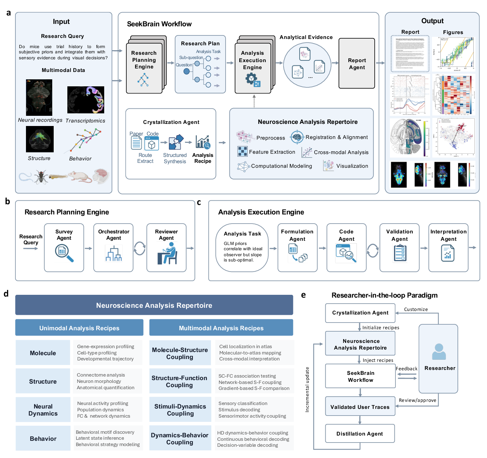
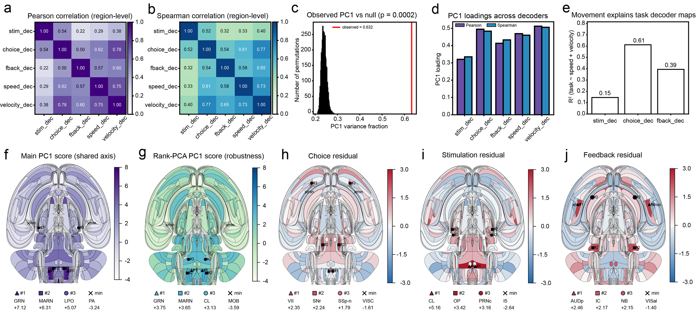

# SeekBrain

[](https://github.com/earendil-works/pi)

[](LICENSE)

SeekBrain is an open-source, domain-specialized multi-agent framework for semi-autonomous neuroscience discovery. It transforms broad scientific questions and heterogeneous, multimodal brain data into hierarchical research plans, executable analysis pipelines, validated figures and statistics, and evidence-grounded conclusions—while keeping researchers in the loop.

<p align="center">
  
</p>

## News

- **2026-07-17** — SeekBrain was released at the WAIC 2026 Science Frontiers Forum.

## Get started

> [!NOTE]
> SeekBrain requires Node.js 22.19 or newer and a supported model-provider API key. Node.js 24 is recommended.

Install SeekBrain from npm:

```bash
npm install --global seekbrain
```

Then launch SeekBrain:

```bash
seekbrain
```

On first launch, SeekBrain guides you through model routing and literature-provider setup. Run `seekbrain --help` to see all commands and options.

## How it works

SeekBrain coordinates specialized agents around a traceable scientific workflow:

```text
research question + multimodal data
  → research planning and review
  → recipe-grounded analytical formulation
  → code generation and execution ↔ scientific validation
  → interpretation and evidence-grounded reporting
```

At its core, a co-evolving **Neuroscience Analysis Repertoire** crystallizes reusable methods from scientific papers and their associated open-source code, as well as researcher-validated execution trajectories. This grounds planning and execution in neuroscience-specific expertise while preserving researcher control and inspectable evidence.

### Distill Recipes

When SeekBrain run produces a processing method / preprocessing flow / whole pipeline worth reusing, distill it into a reusable **recipe** . In the interactive session, after a run finishes:

```bash
/seekbrain-save-recipe
```


## Paper

**SeekBrain: An Autonomous Multi-Agent Framework for Accelerating Neuroscience Discovery**

### Abstract

Modern neuroscience relies on integrating multi-scale, multimodal datasets to uncover the neural principles underlying intelligence. However, the analytical challenges posed by highly heterogeneous data and fragmented workflows increasingly constrain discovery. Here we introduce SeekBrain, a domain-specialized multi-agent framework designed to navigate cross-modal neuroscience data for semi-autonomous discovery. SeekBrain dynamically constructs a repertoire of analysis recipes extracted from code-paper pairs. By coupling this codified expertise with agentic planning and execution engines, the framework scalably generates cross-scale hypotheses and analytical pipelines on demand. Systematic evaluation on the expert-annotated BrainArena benchmark demonstrates that SeekBrain substantially outperforms state-of-the-art agent baselines across multimodal tasks. Crucially, when deployed in real-world research, SeekBrain integrated behavioral, neural, and anatomical data to reveal structured, distributed neural representations of larval zebrafish behavior and a shared axis of regional decoding strength across the brain in a mouse decision-making task. These results demonstrate that SeekBrain can accelerate neuroscience discovery, providing a scalable approach to decode biological intelligence and a promising blueprint for inspiring the next generation of artificial intelligence systems.

<p align="center">
  
</p>

*SeekBrain combines a Research Planning Engine, an Analysis Execution Engine, and a co-evolving Neuroscience Analysis Repertoire in a researcher-in-the-loop workflow.*

### Scientific rediscovery

In a SeekBrain-led, human-supervised reanalysis of the International Brain Laboratory mouse decision-making dataset, SeekBrain identified a shared low-rank axis of regional decoding strength across stimulus, choice, feedback, speed, and velocity decoder maps. Across 201 Beryl brain regions, the first principal component explained 63.2% of the variance, exceeding a 5,000-permutation null distribution (empirical *P* ≈ 0.0002). Rank-based PCA reproduced the regional axis (*r* = 0.96), while movement regression separated shared movement-linked structure from residual task-specific anatomy.

<p align="center">
  
</p>

*A shared regional decoding-strength axis and movement-adjusted residual structure across brain-wide decoder maps.*

## License

SeekBrain is released under the [MIT License](LICENSE).
