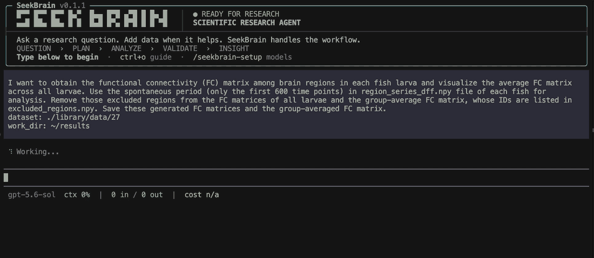
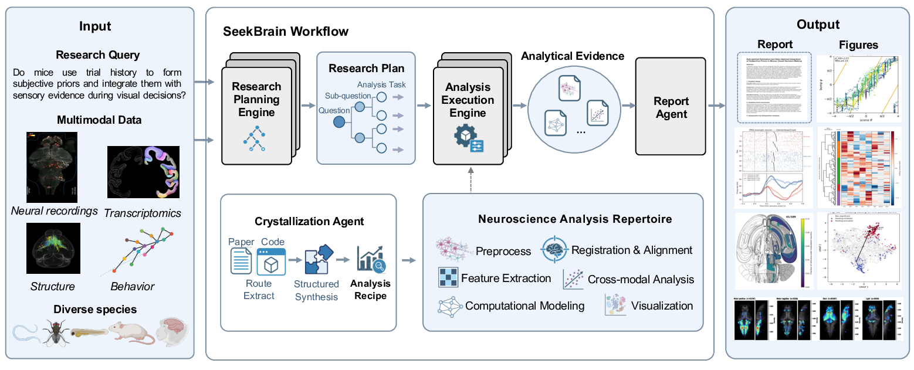
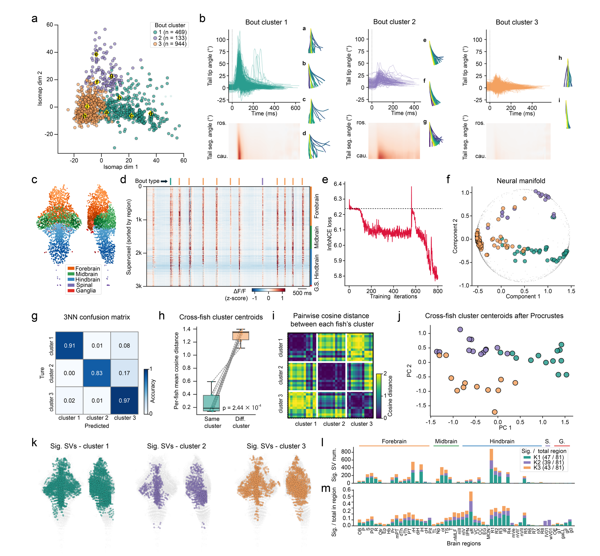
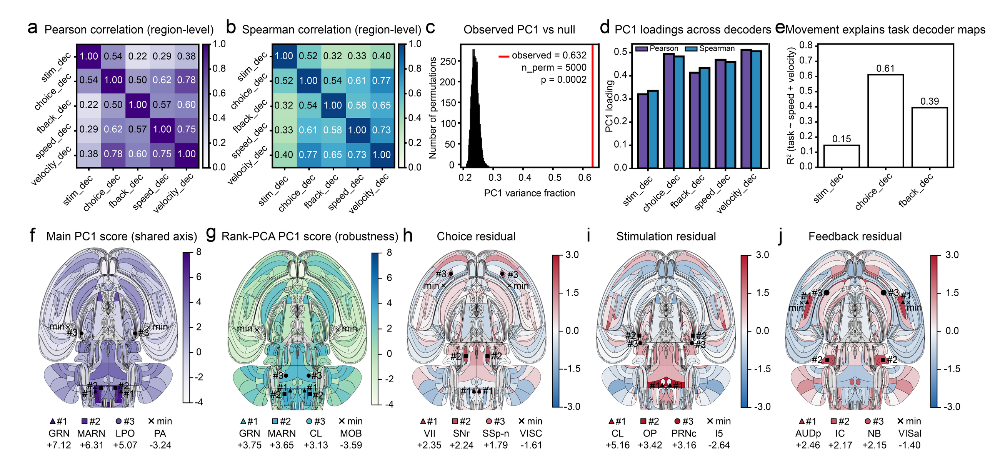

# SeekBrain: An Autonomous Multi-Agent System for Accelerating Neuroscience Discovery

[](https://arxiv.org/abs/2607.29347)
[](https://ai4neurolab.github.io/SeekBrain-page/)
[](https://github.com/earendil-works/pi)

[](LICENSE)

SeekBrain is an open-source, domain-specialized multi-agent framework for
autonomous neuroscience discovery. It transforms broad scientific questions
and heterogeneous, multimodal brain data into hierarchical research plans,
executable analysis pipelines, validated figures and statistics, and
evidence-grounded conclusions—while keeping researchers in the loop.

<p align="center">
  
</p>

**Current source version: 0.1.4.** The previous main is preserved on
[`legacy/0.1.1`](https://github.com/AI4NeuroLab/SeekBrain/tree/legacy/0.1.1).
Version 0.1.4 is being distributed through GitHub; this update does not publish
a new npm version. Platform installation bundles and public one-line install
URLs are still being prepared.

## 本地启动

### 一键安装与发布状态

`scripts/install.sh` 自动准备用户目录内的 Node.js 24，并安装 SeekBrain。
支持 Linux、macOS 的 x64/arm64。Windows x64 已补原生 CLI 兼容实现和
PowerShell 安装器，目前待 Windows CI/实机验收；也可继续使用 WSL。
原生 Windows 使用 Git Bash 执行内部命令，详见 [Windows 开发与安装说明](docs/windows.md)。
`fd`、`rg` 及许可证按五个平台拆成可选 npm 依赖，npm 只安装匹配的一份；
安装和启动时不再到 GitHub 单独下载这两个工具。保留 `seekbrain`、
`seekbrain-014` 和 `seekbrain-pdf` 命令，不替换系统 Node。

当前更新只发布 GitHub 源码，不发布 npm。五个平台的安装包和公网一键安装链接仍在准备，`npm install -g seekbrain` 可能安装旧版，不代表本仓库的 0.1.4。

源码运行需要 Node.js ≥22.19（推荐 24）、Python 和 Bash；原生 Windows 需要 Git Bash，详见 [Windows 说明](docs/windows.md)。平台工具及其许可证保存在 `packages/`，新克隆的源码可直接使用对应平台的一份。

```bash
git clone https://github.com/AI4NeuroLab/SeekBrain.git
cd SeekBrain
npm ci
node bin/seekbrain.mjs setup
node bin/seekbrain.mjs
```

可选的本地安装验证：

```bash
npm run tools:pack -- /tmp/seekbrain-release
bash scripts/install.sh --package . \
  --tools-package /tmp/seekbrain-release/seekbrain-tools-linux-x64-0.1.0.tgz
```

`--package` 也支持主包 `.tgz`；脚本当前默认包名仍指向 npm，验证 014 时必须显式提供源码目录或已构建的本地主包。Python/Bash 自动安装和 GitHub Release 下载入口尚未接入。离线验证还需预先缓存 Node 和 npm 依赖，详见安装脚本 `--help`。

### 网页端

网页端基于 pi-web，使用同一个 Pi 1.2.0 SDK 和 SeekBrain 科研流程。
先安装 Web 开发依赖并启动源码预览：

```bash
npm --prefix web ci
node bin/seekbrain.mjs web --dev --cwd /path/to/project
```

终端会显示带项目路径的网页地址，默认监听 `127.0.0.1:30141`。
也支持 `node bin/seekbrain.mjs --ui webui --cwd /path/to/project`。
网页提供聊天、历史会话、Ask / Plan / Research / Deep Research 切换和文件预览。
模型、Fast 模型和文献源沿用 `seekbrain setup` 的配置；项目配置和 `.env`
按会话加载，不写回服务进程的全局环境。同一科研任务的写入使用文件锁互斥。

内网访问可设置 `PI_WEB_PASSWORD` 后使用 `--hostname 0.0.0.0`，端口通过
`--port` 指定。当前面向单个用户运行。源码开发可先运行 `npm --prefix web ci`，
再用 `npm run web:dev` 启动；发布构建使用 `npm run web:build`，与开发缓存隔离。
详细开发说明见 [web/README.md](web/README.md)。

### Anthropic 中转兼容性

SeekBrain 自建的 `anthropic-relay` 默认关闭对话中途修改思考强度、system 消息和
工具定义三项扩展，保留自适应思考。CLI、WebUI 启动及配置界面会自动升级已有
中转配置，避免 Opus 5.5 经 Bedrock 通道时因空 system 内容返回 400。

对关闭上述中途扩展的 Opus 5.5 中转，SeekBrain 还会记录历史 thinking 对应的请求前缀。
前置系统提示、工具定义或历史内容改变时，只从受影响处清理旧 thinking；普通回答、
工具调用和结果保留。清理状态以哈希元数据保存在 agent 目录的
`seekbrain/thinking-bindings/`，重启后继续使用，原始会话文件不被改写。
没有元数据的旧会话先正常发送；只有遇到明确的前缀签名不匹配，才清理并重试一次。
其他 400、签名损坏、取消或已经开始输出内容的失败不会触发这次重试。
官方 Anthropic 和其他模型沿用 Pi 的原有处理。升级后需重启 CLI / WebUI 进程。

### 已有 Node 环境

需要 Node.js ≥22.19，推荐 Node.js 24。配置模型后运行：

```bash
seekbrain-014 setup
seekbrain-014
```

自动执行与报告：

```bash
seekbrain-014 run --query '分析 ./Datasets/D01，参考 ./References，实施计划并生成报告。' --work-dir ./Q1
seekbrain-014 report ./Q1
```

## 模式与交付文件

新会话默认 **Research**。终端常驻显示 **Ask / Plan / Research / Deep Research**；单独输入命令只切换模式，命令后附请求则立即处理。恢复会话时保留模式和当前项目。Deep Research 根据每轮报告及实际任务结果，决定继续研究或结束；一轮可以完成。

```text
/ask 解释这个指标的含义
/plan 参考 ./References，生成 baseline.md 和 exploratory.json
/plan 修改 exploratory.json，改成按动物做统计
/research 按 exploratory.json 执行，最后只给我 ./results/report-0001.pdf
/deep-research 分析 ./Datasets/D01，参考 ./References，根据结果决定是否补充分析，输出到 ./Q1
```

Ask 仅对话和按需读取/检索，不修改用户文件。Plan 支持多份 Markdown、JSON、文本或 YAML 计划与持续修订，不启动编排、执行或报告；未指定输出目录时直接使用当前目录，不额外套项目目录。JSON 计划遵循用户结构，不强制转换为 Markdown。Research 支持执行用户已有的计划；候选计划未选定时先澄清。

Ask 和 Plan 均可使用 Bash 探索材料。Ask 通过提示词保持用户文件和环境不变，不开放计划生成等科研工作流工具；Plan 可生成计划文件，完整分析交给后续执行阶段。临时提取文件放在临时目录。文档和数据读取使用已有环境中的解析工具与库，不自动安装依赖或切换环境。

PDF 开关：默认开启；持久关闭可运行 `seekbrain config set workflow.seekbrain.report.pdf.enabled false`。`--pdf` 强制本次生成 PDF，`--no-pdf` 强制本次仅生成 Markdown，优先于配置和 Agent 的输出格式选择；不修改持久配置。Research、Deep Research、报告生成及恢复运行共用此设置。

```bash
seekbrain run --no-pdf --query "分析数据并生成结论" --work-dir ./results
seekbrain run --pdf --query "分析数据并生成报告" --work-dir ./results
seekbrain report ./results --no-pdf
seekbrain --mode deep-research --no-pdf
```

程序尊重指定文件名和路径。默认交付 `report.md` 与 `report.pdf`；只要求 PDF 时使用内部 Markdown 草稿，其他命名报告保留。终端展示实际活动、任务状态和文件路径，不再展示固定四阶段进度条及 Plan/Formulation 计时。

非交互入口同样支持模式：

```bash
seekbrain-014 run --mode plan --query '生成 analyze.json 中的分析计划' --work-dir ./Q1
seekbrain-014 run --mode deep-research --query '分析 ./Datasets/D01，参考 ./References，实施研究并根据结果决定是否继续。' --work-dir ./Q1
seekbrain-014 run --mode ask --query '读取 ./References/notes.md，解释研究背景'
```

## 对话与提示词

主智能体使用统一的四模式说明，结合当前模式和项目理解本次请求。讨论结果、聊天草稿和局部文件修改各自按请求范围处理；完整研究才使用完整研究流程。普通对话无需重复声明模式限制，需要切换时直接给出准确命令。

交互和 CLI 都传递普通用户消息，不再通过 `/entry` 包装。`prompts/assistant.md` 提供身份、模式定义和交流原则；`prompts/research.md` 提供按需研究操作指引。SeekBrain 将它们增补到 Pi 的系统提示分区，保留项目说明、工作目录、工具和 Skill 上下文。

## Research 内部流程

- **Plan：** 探索实际数据、用户参考材料和文献，直接写科学计划。
- **Formulation：** 按需要形成单任务、串行、并行或混合任务图；没有执行合同和统一交付清单。
- **Code / Validation：** 接受实际生成的代码、图表、表格、数组或目录，区分计算、科学验证与文件整理问题；局部结果可供后续任务使用。
- **Report：** 统一形成解释、结论和参考文献，直接写指定 Markdown 路径，由程序导出指定 PDF 路径。

用户指定的输出目录就是研究根目录，不追加 `_project`。单任务直接在根目录运行，多任务可分配 tasks/<id> 工作位置。内部状态放在 `.seekbrain`。整个输出目录移动后，可从新路径恢复。

不强制 statistics.json、代码目录、conclusion.md、报告 handoff 或每项任务的图表。已有结果可以复用，缺辅助文件或日志失败不会阻断计算。真正的科学错误继续验证和修复。Code 和 Validation 不设整阶段硬超时；中断不会自动新开 Agent 重试三次，保留结果供明确恢复。新状态不兼容旧版本项目。

## Deep Research

完整研究按 `Plan → Formulation → Code / Validation → Report.md → 继续或结束` 运行。主 Agent 阅读报告和必要的任务/验证结果，记录继续的科学理由及下一步方向，或结束研究。后续轮次只安排新增或需要纠正的工作，复用已有结果；失败任务不会因为进入下一轮而全部重跑。后续方向保留为 Agent 的建议，不写成用户要求。

默认最多 3 轮，包含首轮，可通过项目配置调整：

```yaml
workflow:
  seekbrain:
    deep_research:
      max_rounds: 3
```

每轮更新累计 Markdown 报告，结束时导出最终 PDF；达到轮数上限不代表科学问题已经解决。Deep Research 的任务统一放在 `tasks/r01_<id>`、`tasks/r02_<id>` 等目录，历史计划和报告保存在 `.seekbrain/rounds/`。原输出根目录和用户指定文件名保留。中断从当前步骤恢复；PDF 导出失败只重试导出。已完成的 014 Research 项目可在用户要求继续时直接用于判断下一步。

旧文献背景生成模块已移除；Plan/Report 继续使用两个文献工具与各自 Skill。文献源选择 None 不会禁用 Deep Research 模式。

## 报告

保留 14 个教材阅读 Skill、用户材料和文献检索能力。默认格式为 3 句、最多 70 词的无引用摘要，1000–1500 词无标题正文，最多 3 个展示项与 25 条参考文献；用户明确要求优先。Report Agent 在同一次调用中读回并局部修改格式，不经过外围格式解析审查。程序导出 PDF；导出失败保留 Markdown 并清理旧版或未完成的 PDF。

详见 [开发与运行说明](DEVELOPMENT-014.md)。

## 许可证

项目遵循 [MIT](LICENSE)。依赖与素材说明见 [NOTICE](NOTICE) 和 [THIRD_PARTY_NOTICES](THIRD_PARTY_NOTICES.md)。

## Web access

主 Agent（包括 Ask）、Plan 和 Report 可按需使用 `web_search`、`fetch_content`、`get_search_content`；编排、Code 和 Validation 不增加网页工具。复用固定版本 `pi-web-access@0.42.0` 的工具核心，不加载其扩展界面、动态工具开关、自动摘要或模型问答。

默认开启。关闭可运行 `seekbrain config set workflow.seekbrain.web_search false`，重新启动后生效；恢复时将 `false` 改为 `true`。关闭后主 Agent、Plan 和 Report 不提供上述三个网页工具，直接调用也会被拒绝；`seekbrain_literature_search` 与 `seekbrain_paper_read` 的 RAG 检索不受影响。此开关仅控制网页工具，不限制 Bash 的网络访问。

搜索固定使用 Exa：未配置 Exa Key 时使用免 Key 的 Exa MCP。已有 Exa Key/地址等可选设置沿用上游 `web-search.json`（通常位于 `~/.pi/agent/`）；不自动选择 OpenAI 或其他模型搜索，也不修改模型、中转、环境或已有配置文件。普通网页默认直接读取；上游已有的代理和抓取配置仍适用。PDF 等特殊文档的解析沿用上游设置，默认可在本地解析；不会开放视频分析或网页模型问答参数。

搜索返回标题、URL 和摘要片段；读取网页后，可用 `get_search_content` 按位置分段读取或用 `findText` 查找。缓存共用于主 Agent、Plan 和 Report，保存在 `~/.cache/seekbrain/web`，一小时有效，最多 128 项/64 MiB，单项最多 4 MiB。超大内容仍可在当前进程内读取；缓存过期或重启后未能恢复时重新抓取 URL。参考文献记录实际来源 URL/DOI，不使用临时 responseId。

联网超时、限流和不可读网页返回工具错误，由 Agent 判断如何继续，不直接改变科研任务状态。现有文献工具和本地材料读取方式保留；不增加强制检索步骤。


## 🎯 BrainArena

[BrainArena](BrainArena/README.md) is a benchmark designed to test how well LLM
agents handle complex analyses of multimodal neuroscience data. It includes 32
tasks constructed from selected neuroscience studies. Each task includes an
expert-annotated analysis query and a scoring rubric.

Browse the [queries and rubrics](BrainArena/README.md#queries-and-rubrics) and
follow the [data preparation guide](BrainArena/DATASETS.md). Give the agent an
analysis query file and one accessible data-root path, for example from the
repository root:

```text
Read the analysis query file, inspect the dataset, and complete the analysis.

query: BrainArena/queries/atanas_2023/Fig_1H.md
dataset: /path/to/data
```

Rubrics are for evaluation and are not part of the agent's task input.

<a id="paper"></a>

## 📚 Paper

**SeekBrain: An Autonomous Multi-Agent Framework for Accelerating Neuroscience Discovery**

### Overview

SeekBrain accelerates neuroscience discovery through domain-grounded hierarchical
planning and cross-modal data analysis. It combines a dynamically evolving
Neuroscience Analysis Repertoire with a Research Planning Engine, an Analysis
Execution Engine, scientific validation, and researcher-in-the-loop feedback.

<p align="center">
  
</p>

<p align="center"><em>Figure 1. SeekBrain couples a Research Planning Engine and an Analysis Execution Engine with a co-evolving Neuroscience Analysis Repertoire and hierarchical evidence reporting.</em></p>

### Real-World Case Studies

Two real-world case studies demonstrate SeekBrain's capability to drive
scientific exploration under both researcher-guided and fully autonomous modes,
revealing novel neural structures, testing cross-region hypotheses, and enabling
researchers to maintain control over key scientific decisions while delegating
routine analysis.

<details>
<summary><b>1. Zebrafish Behavior and Brain-Wide Dynamics</b></summary>

SeekBrain connected free-moving behavior, whole-brain calcium activity, and
anatomy. It clustered 1,546 swimming bouts, compressed 64,000+ neural ROIs into
region-aware supervoxels, and uncovered a cross-animal latent geometry of
behavior.

- **94.9%** — 3-NN decoding accuracy
- **3,000** — supervoxels per larva
- **81** — anatomical regions tested

<p align="center">
  
</p>

<p align="center"><em>Figure 2. Structured neural representations of zebrafish behavior.</em></p>

</details>

<details>
<summary><b>2. Mouse Decision-Making</b></summary>

On the IBL decision-making dataset, SeekBrain proposed a region-level hypothesis,
tested it across five decoder maps, and separated shared movement-linked geometry
from task-specific residual anatomy.

- **63.2%** — variance explained by PC1
- **201** — brain regions analyzed
- **0.96** — rank/value PC1 correlation

<p align="center">
  
</p>

<p align="center"><em>Figure 3. Brain-wide decoder maps in a mouse decision-making task.</em></p>

</details>

## 🤝 Acknowledgements

SeekBrain is built on [Pi](https://github.com/earendil-works/pi), with
[PDFKit](https://github.com/foliojs/pdfkit),
[Marked](https://github.com/markedjs/marked), and
[STIX General](assets/fonts/LICENSE_STIX.txt) supporting scientific reporting.
We thank their maintainers and the neuroscience researchers and open-data
initiatives whose datasets, publications, and code enable reproducible discovery.
See [THIRD_PARTY_NOTICES.md](THIRD_PARTY_NOTICES.md) for licenses and notices.

## 📜 License

SeekBrain is released under the [MIT License](LICENSE).

## 📝 Citation

If you find **SeekBrain** useful in your research, please consider citing our paper:

```bibtex
@article{wu2026seekbrain,
  title         = {SeekBrain: An Autonomous Multi-Agent System for Accelerating Neuroscience Discovery},
  author        = {Wu, Jiamin and Xiang, Peishan and Chen, Jingyang and Zhu, Yuqing and Li, Yuxi and Luo, Ling and Zheng, Qihao and Zu, Jialiang and Wu, Yongchao and Liu, Mindong and Wu, Haitao and Hu, Chaofan and Sun, Yijie and Hang, Yuqi and Zhu, Yu and Li, Shuo and Fan, Yue and Feng, Shiyang and Xu, Wanghan and Zhang, Tianlei and Zhang, Jie and Zhang, Wenlong and Zhang, Bo and Wang, Kai and Bai, Lei and Liu, Mianxin and Ouyang, Wanli and Du, Jiulin and Song, Chunfeng},
  journal       = {arXiv preprint arXiv:2607.29347},
  year          = {2026},
}
```
