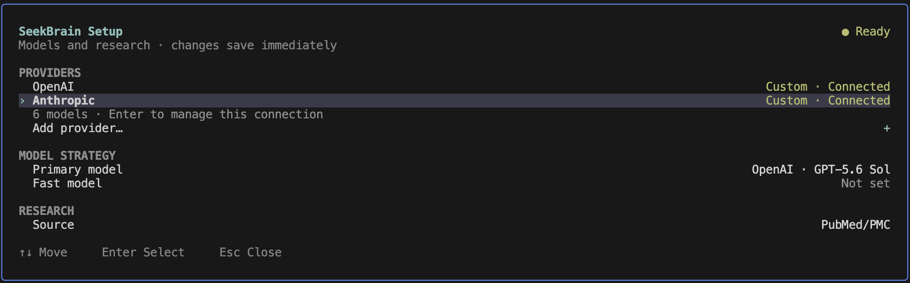
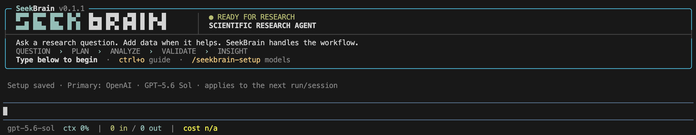
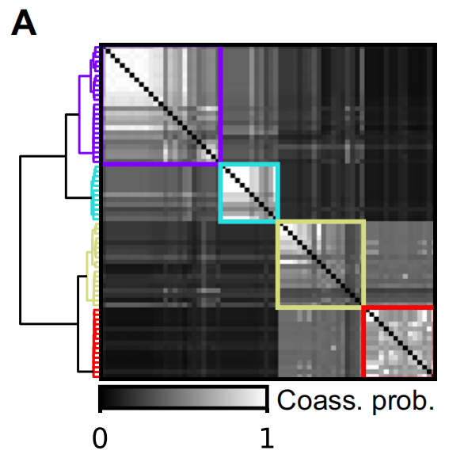
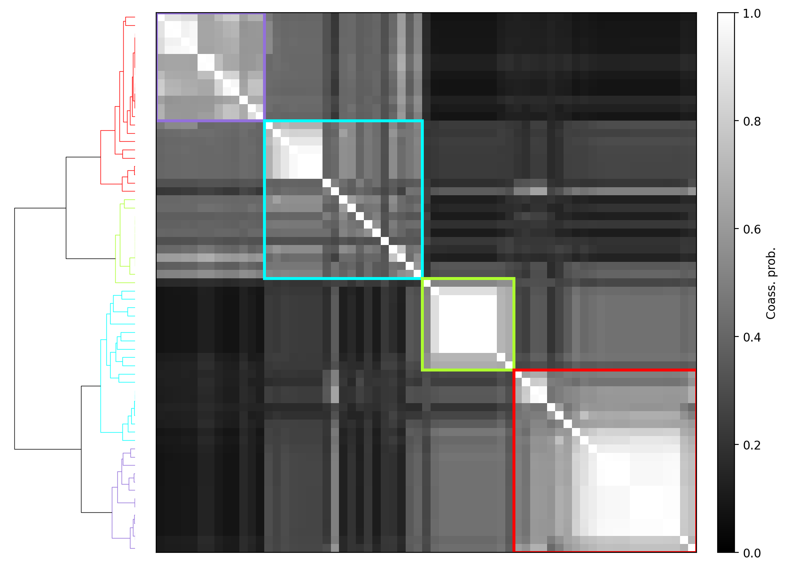
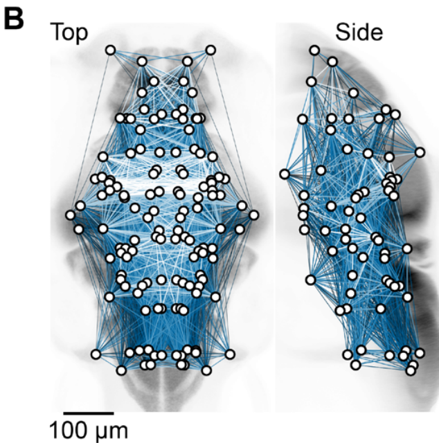
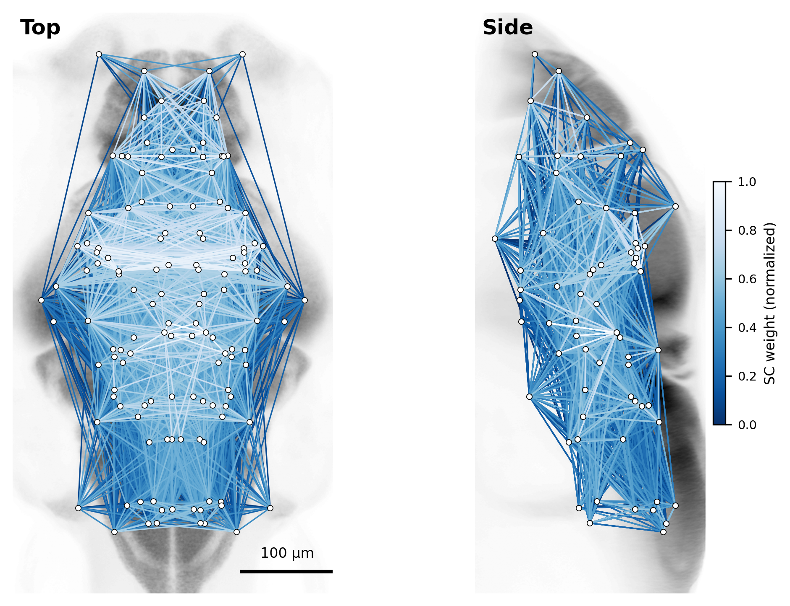

# SeekBrain: An Autonomous Multi-Agent System for Accelerating Neuroscience Discovery

[](https://arxiv.org/abs/2607.29347)
[](https://ai4neurolab.github.io/SeekBrain-page/)
[](https://www.npmjs.com/package/seekbrain)
[](https://www.npmjs.com/package/seekbrain)
[](https://github.com/earendil-works/pi)

[](LICENSE)

SeekBrain is an open-source, domain-specialized multi-agent framework for
autonomous neuroscience discovery. It transforms broad scientific questions
and heterogeneous, multimodal brain data into hierarchical research plans,
executable analysis pipelines, validated figures and statistics, and
evidence-grounded conclusions—while keeping researchers in the loop.

<p align="center">
  
</p>

<a id="highlights"></a>

## ✨ Highlights

- **🧰 Neuroscience Analysis Repertoire** — Foundational recipes spanning four data modalities and eight analysis families, from preprocessing to visualization.
- **🔬 Analysis Execution Engine** — A recipe-grounded four-phase workflow—Formulate → Code → Validate → Interpret—adapts established neuroscience methods to new data and guards against methodological hallucinations before final interpretation.
- **🌳 Research Planning Engine** — Orchestrator–Reviewer debate decomposes each query into hypotheses and atomic tasks, producing a transparent research tree traceable to the original question.
- **🧑‍🔬 Researcher in the Loop** — Scientists guide planning, methodology, and analysis at every stage, turning expert feedback into persistent learning signals.
- **🔄 Co-Evolving Analysis Repertoire** — Distills validated research traces and expert feedback into reusable recipes, allowing the repertoire to grow across sessions, studies, and the research community.
- **📄 Traceable Scientific Reports** — Produces publication-style Markdown and PDF reports whose conclusions remain linked to supporting task rounds, statistics, figures, and limitations.

## 📦 Install

> [!NOTE]
> Requires Node.js 22.19 or newer. Node.js 24 is recommended.

```bash
npm install --global seekbrain
```

## ⚙️ Setup

The easiest way to configure SeekBrain is the interactive setup wizard:

```bash
seekbrain setup
```

> [!TIP]
> It guides you through official or custom provider connections, API-key or
> supported OAuth authentication, Primary and Fast model selection, and optional
> literature source setup.

<p align="center">
  
</p>

Then launch SeekBrain:

```bash
seekbrain
```

<p align="center">
  
</p>

Run `seekbrain -h` to see all available commands and options.

### Change configuration

- **Interactive** — Run `seekbrain setup` again, or use `/seekbrain-setup` from
  within SeekBrain.
- **CLI** — Inspect or update public configuration values:

  ```bash
  seekbrain config show --effective
  seekbrain config get <key>
  seekbrain config set <key> <value>
  seekbrain config unset <key>
  ```

- **Config files** — Edit `~/.config/seekbrain/config.yaml` for user-wide
  settings, or `<project>/seekbrain.config.yaml` for project-specific overrides.
  See the [configuration reference](config/README.md) for available fields.

<a id="how-it-works"></a>

## 🧭 How It Works

### 🔬 Analysis Execution Engine

Each analysis follows a recipe-grounded four-phase workflow: **Formulate → Code
→ Validate → Interpret**. Established neuroscience methods are adapted to new
data, while the Validation Agent catches methodological errors before final
interpretation.

After launching SeekBrain, ask:

```text
Compare neural activity between the experimental conditions and identify the
strongest group differences.

Dataset: /path/to/dataset
```

Or let SeekBrain run the same analysis automatically:

```bash
seekbrain run \
  --query "Compare neural activity between the experimental conditions" \
  --dataset /path/to/dataset \
  --work-dir results/analysis
```

> [!NOTE]
> `seekbrain run` carries the workflow through subsequent approval gates
> automatically.

After a run passes Validation, save its executed workflow as a reusable analysis
recipe:

```text
/seekbrain-save-recipe
```

<details>
<summary><b>Example 1: Hierarchical zebrafish SC modules</b></summary>

Enter the following prompt after launching `seekbrain`:

```text
Identify structural connectivity (SC) network modules using hierarchical
consensus analysis. Build a co-assignment probability matrix from iterative
Louvain modularity optimization, then apply Ward-linkage hierarchical clustering
and show the four-module partition with thick boxes. Plot the dendrogram to the
left of the matrix. Use SC_matrix_directed_terminals_expanded.npy and exclude the
regions listed in excluded_regions.npy.

Dataset: "$(npm root --global)/seekbrain/examples/zebrafish-sc-network-modules"
```

<table>
  <tr>
    <td align="center" width="42%">
      <br>
      <em>Original Figure 3A from Légaré et al. (2025).</em>
    </td>
    <td align="center" width="58%">
      <br>
      <em>SeekBrain reproduction.</em>
    </td>
  </tr>
</table>

The processed source dataset is available under [CC BY
4.0](https://creativecommons.org/licenses/by/4.0/) at
[doi:10.5683/SP3/IIVGOB](https://doi.org/10.5683/SP3/IIVGOB), with original
analysis code at
[pdesrosiers/Legare-zebrafish-brain-networks](https://github.com/pdesrosiers/Legare-zebrafish-brain-networks).

</details>

<details>
<summary><b>Example 2: SC network overlay on the zebrafish brain atlas</b></summary>

Enter the following prompt after launching `seekbrain`:

```text
Visualize the structural connectivity (SC) network on the zebrafish brain atlas.
Use SC_matrix_undirected_terminals_expanded.npy to build a bilateral SC matrix,
remove the regions listed in excluded_regions.npy from both hemispheres, and load
the left- and right-brain regional centroids from the atlas folder. Align the
centroids with the top and side brain projections, then overlay the network with
edges colored by SC weight.

Dataset: "$(npm root --global)/seekbrain/examples/zebrafish-sc-network-modules"
```

<table>
  <tr>
    <td align="center" width="36%">
      <br>
      <em>Original Figure 2B from Légaré et al. (2025).</em>
    </td>
    <td align="center" width="64%">
      <br>
      <em>SeekBrain reproduction.</em>
    </td>
  </tr>
</table>

</details>

### 🌳 Research Planning Engine

Research Planning turns complex questions into a traceable tree: **query →
hypotheses → atomic tasks**. When literature access is configured, a Survey Agent
supplies context; the Orchestrator and Reviewer refine the plan before researcher
review and parallel execution.

For questions that require multiple linked hypotheses, enable Research Planning:

```bash
seekbrain run \
  --research-planning \
  --query "Investigate how individual variability, brain-network organization, and behavior are related" \
  --dataset /path/to/dataset \
  --work-dir results/study
```

After the selected research tasks finish, generate an academic report with:

```text
/seekbrain-report
```

## 🎯 BrainArena

[BrainArena](BrainArena/README.md) is a benchmark designed to test how well LLM
agents handle complex analyses of multimodal neuroscience data. It includes 32
tasks constructed from selected neuroscience studies. Each task includes an
expert-annotated analysis query and a scoring rubric.

Browse the [queries and rubrics](BrainArena/README.md#queries-and-rubrics) and
follow the [data preparation guide](BrainArena/DATASETS.md). Give the agent an
analysis query file and one accessible data-root path, for example from the
repository root:

```text
Read the analysis query file, inspect the dataset, and complete the analysis.

query: BrainArena/queries/atanas_2023/Fig_1H.md
dataset: /path/to/data
```

Rubrics are for evaluation and are not part of the agent's task input.

<a id="paper"></a>

## 📚 Paper

**SeekBrain: An Autonomous Multi-Agent Framework for Accelerating Neuroscience Discovery**

### Overview

SeekBrain accelerates neuroscience discovery through domain-grounded hierarchical
planning and cross-modal data analysis. It combines a dynamically evolving
Neuroscience Analysis Repertoire with a Research Planning Engine, an Analysis
Execution Engine, scientific validation, and researcher-in-the-loop feedback.

<p align="center">
  
</p>

<p align="center"><em>Figure 1. SeekBrain couples a Research Planning Engine and an Analysis Execution Engine with a co-evolving Neuroscience Analysis Repertoire and hierarchical evidence reporting.</em></p>

### Real-World Case Studies

Two real-world case studies demonstrate SeekBrain's capability to drive
scientific exploration under both researcher-guided and fully autonomous modes,
revealing novel neural structures, testing cross-region hypotheses, and enabling
researchers to maintain control over key scientific decisions while delegating
routine analysis.

<details>
<summary><b>1. Zebrafish Behavior and Brain-Wide Dynamics</b></summary>

SeekBrain connected free-moving behavior, whole-brain calcium activity, and
anatomy. It clustered 1,546 swimming bouts, compressed 64,000+ neural ROIs into
region-aware supervoxels, and uncovered a cross-animal latent geometry of
behavior.

- **94.9%** — 3-NN decoding accuracy
- **3,000** — supervoxels per larva
- **81** — anatomical regions tested

<p align="center">
  
</p>

<p align="center"><em>Figure 2. Structured neural representations of zebrafish behavior.</em></p>

</details>

<details>
<summary><b>2. Mouse Decision-Making</b></summary>

On the IBL decision-making dataset, SeekBrain proposed a region-level hypothesis,
tested it across five decoder maps, and separated shared movement-linked geometry
from task-specific residual anatomy.

- **63.2%** — variance explained by PC1
- **201** — brain regions analyzed
- **0.96** — rank/value PC1 correlation

<p align="center">
  
</p>

<p align="center"><em>Figure 3. Brain-wide decoder maps in a mouse decision-making task.</em></p>

</details>

## 🤝 Acknowledgements

SeekBrain is built on [Pi](https://github.com/earendil-works/pi), with
[PDFKit](https://github.com/foliojs/pdfkit),
[Marked](https://github.com/markedjs/marked), and
[STIX General](assets/fonts/LICENSE_STIX.txt) supporting scientific reporting.
We thank their maintainers and the neuroscience researchers and open-data
initiatives whose datasets, publications, and code enable reproducible discovery.
See [THIRD_PARTY_NOTICES.md](THIRD_PARTY_NOTICES.md) for licenses and notices.

## 📜 License

SeekBrain is released under the [MIT License](LICENSE).

## 📝 Citation

If you find **SeekBrain** useful in your research, please consider citing our paper:

```bibtex
@article{wu2026seekbrain,
  title         = {SeekBrain: An Autonomous Multi-Agent System for Accelerating Neuroscience Discovery},
  author        = {Wu, Jiamin and Xiang, Peishan and Chen, Jingyang and Zhu, Yuqing and Li, Yuxi and Luo, Ling and Zheng, Qihao and Zu, Jialiang and Wu, Yongchao and Liu, Mindong and Wu, Haitao and Hu, Chaofan and Sun, Yijie and Hang, Yuqi and Zhu, Yu and Li, Shuo and Fan, Yue and Feng, Shiyang and Xu, Wanghan and Zhang, Tianlei and Zhang, Jie and Zhang, Wenlong and Zhang, Bo and Wang, Kai and Bai, Lei and Liu, Mianxin and Ouyang, Wanli and Du, Jiulin and Song, Chunfeng},
  journal       = {arXiv preprint arXiv:2607.29347},
  year          = {2026},
}
```
