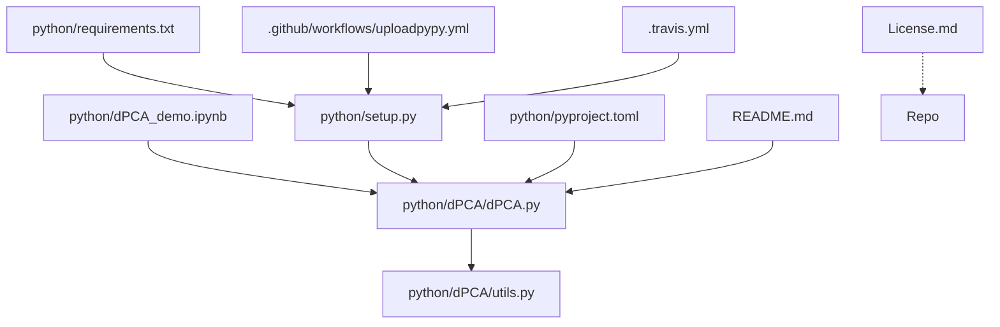

# Repository Overview

This repository provides the official implementation of **Demixed Principal Component Analysis (dPCA)**, a neuroscientific dimensionality reduction technique. It is designed to decompose complex neural population activity into interpretable latent components that represent specific task parameters (e.g., stimuli, decisions, and time).

### 1. Repository Purpose
The repository aims to provide researchers with a robust, scikit-learn-compatible toolkit to analyze neural population dynamics. By moving beyond standard PCA—which often conflates task-related signals—dPCA allows for the independent visualization and analysis of neural responses to varied experimental conditions, facilitating a deeper understanding of how the brain represents task-relevant information.

### 2. Data Pipeline
1.  **Ingestion**: Receives multi-dimensional neural data arrays (Neurons × Time × Task Parameters).
2.  **Marginalization**: The algorithm decomposes the data into "marginalizations" by averaging across conditions to isolate specific effects (e.g., stimulus-specific variance vs. time-dependent variance).
3.  **Regularization**: Applies ridge-type regularization, optionally optimized via cross-validation, to ensure stable decomposition.
4.  **Decomposition**: Performs Singular Value Decomposition (SVD) on the marginalized data to extract latent dimensions ($Z$).
5.  **Validation**: Uses shuffling procedures and classification metrics to test the statistical significance and predictive power of the extracted components.

### 3. Key Scripts & Their Roles
*   **`python/dPCA/dPCA.py`**: The core library containing the `dPCA` estimator class. Handles all algorithmic logic, marginalization, and model fitting.
*   **`python/dPCA/utils.py`**: A performance-focused utility module providing JIT-compiled (Numba) helpers for denoising, shuffling, and nearest-centroid classification.
*   **`python/dPCA_demo.ipynb`**: An interactive tutorial demonstrating synthetic data generation, model fitting, and significance analysis.
*   **`python/setup.py` & `pyproject.toml`**: Standard packaging scripts defining project metadata and installation requirements.
*   **`.github/workflows/uploadpypy.yml` / `.travis.yml`**: CI/CD configuration files that automate testing and deployment to the Python Package Index (PyPI).

### 4. Analysis Methods Implemented
*   **Demixed PCA (dPCA)**: The primary technique for disentangling neural variance along specific experimental axes.
*   **Automatic Regularization**: Iterative search for optimal lambda values to balance reconstruction performance and model simplicity.
*   **Permutation Testing**: A non-parametric method to assess the significance of the extracted latent components by shuffling data labels.
*   **Nearest-Centroid Classification**: Used in `utils.py` to evaluate the discriminative power of the neural population representation.

### 5. Outputs & Figures
*   **Latent Components ($Z$)**: Structured dictionaries containing the transformed neural trajectories for each task parameter.
*   **Explained Variance**: Numerical output detailing how much of the population variance is captured by each demixed component.
*   **Visualization**: The `dPCA_demo.ipynb` generates plots showing time-resolved component dynamics, with significance markers (masks) indicating reliable time points.

### 6. Dependencies & Environment
*   **Core Scientific Stack**: `numpy`, `scipy`, `scikit-learn`.
*   **Performance Optimization**: `numba` (JIT compilation), `numexpr` (high-speed numerical evaluation).
*   **Environment**: Designed for Python 3.x with standard packaging management (`pip`, `setuptools`).

### 7. File Dependency Graph

Repository Structure:
  .github/workflows/uploadpypy.yml (651 chars)
  .travis.yml (973 chars)
  License.md (1068 chars)
  README.md (3083 chars)
  python/dPCA/dPCA.py (40698 chars)
  python/dPCA/utils.py (1494 chars)
  python/dPCA_demo.ipynb (2844 chars)
  python/pyproject.toml (711 chars)
  python/requirements.txt (39 chars)
  python/setup.py (1141 chars)