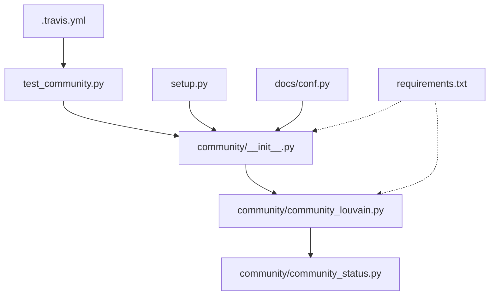

# Repository Overview

This repository contains the `python-louvain` library, a scientific Python implementation of the **Louvain algorithm** for community detection in complex networks. It is designed to work natively with `networkx` to identify modular structures, hierarchical clusters, and topological partitions within graph datasets.

---

### 1. Repository Purpose
The primary purpose of this repository is to provide a robust, documented, and tested tool for **network community detection**. It enables researchers and data scientists to analyze the structural organization of graphs, specifically by optimizing modularity (a measure of the strength of division of a network into communities).

### 2. Data Pipeline
The typical workflow for this repository follows a standard scientific data analysis pattern:
1.  **Ingestion**: Graphs are represented as `networkx` objects or loaded from legacy binary formats.
2.  **State Initialization**: The `Status` object tracks degrees, internal weights, and node assignments.
3.  **Optimization**: The Louvain heuristic iteratively reassigns nodes to maximize modularity.
4.  **Transformation**: The graph is iteratively "collapsed" into an induced graph, where nodes represent discovered communities.
5.  **Egress**: Results are returned as structured data (dictionaries mapping nodes to community IDs, or dendrograms representing hierarchical levels).

### 3. Key Scripts & Their Roles
*   **`community/community_louvain.py`**: The core logic module. Implements the Louvain heuristic, modularity calculations, and graph contraction.
*   **`community/community_status.py`**: A helper module defining the `Status` class; acts as the "state manager" for the partitioning process.
*   **`community/__init__.py`**: Exposes the high-level API (`best_partition`, `modularity`, etc.) for user accessibility.
*   **`test_community.py`**: The validation suite. It uses synthetic benchmarks (e.g., Girvan-Newman graphs) to ensure algorithmic correctness and numerical stability.
*   **`setup.py` & `.travis.yml`**: Infrastructure files ensuring the project can be installed as a standard package and tested automatically across diverse Python/Architecture environments.

### 4. Analysis Methods Implemented
*   **Louvain Method**: A greedy optimization heuristic for modularity.
*   **Hierarchical Clustering**: Generation of a multi-level dendrogram to view network structure at different resolutions.
*   **Modularity Optimization**: The primary objective function (Newman-Girvan modularity) used to quantify "community-ness."
*   **Resolution Tuning**: A parameter-based approach to control the size/granularity of detected communities.

### 5. Outputs & Figures
*   **Quantitative Results**: Returns Python dictionaries (node-to-community mapping), scalar modularity scores, and aggregated graph structures.
*   **Documentation**: The repository generates HTML and LaTeX documentation via `Sphinx`, providing a complete API reference.
*   **Execution Logs**: The test suite provides terminal-based status reports; no graphical visualizations are generated natively by the library (it relies on `networkx` and `matplotlib` for external visualization).

### 6. Dependencies & Environment
*   **Core Libraries**: `networkx` (Graph data structures), `numpy` (Numerical optimization).
*   **Documentation**: `numpydoc`, `Sphinx`.
*   **Environment**: Requires `pip` for installation; supports cross-platform testing (AMD64, PPC64LE) via `Travis CI`.

### 7. File Dependency Graph

Repository Structure:
  .travis.yml (224 chars)
  community/__init__.py (508 chars)
  community/community_louvain.py (18721 chars)
  community/community_status.py (2957 chars)
  docs/conf.py (6724 chars)
  requirements.txt (24 chars)
  setup.py (666 chars)
  test_community.py (14385 chars)