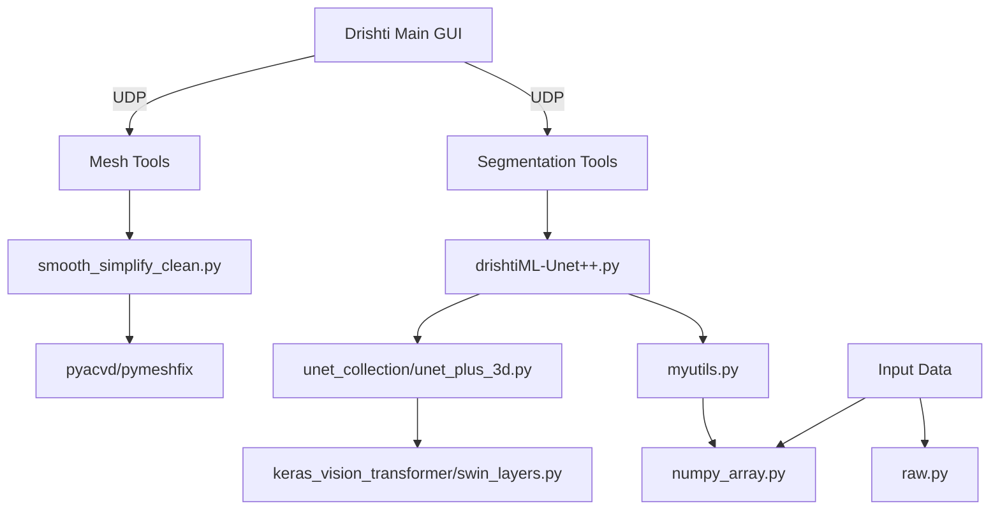

# Repository Overview

This document provides a comprehensive overview of the `Drishti` scientific research repository, a specialized suite for 3D volumetric visualization, segmentation, and machine-learning-based analysis.

---

### 1. Repository Purpose
**Drishti** is an integrated software ecosystem designed to facilitate the exploration, presentation, and automated segmentation of scientific volumetric data (e.g., tomography, electron microscopy). It bridges the gap between raw data acquisition and actionable scientific insight through high-performance GPU-accelerated rendering and a suite of deep-learning-based segmentation tools.

### 2. Data Pipeline
The repository manages data through a structured pipeline:
1.  **Ingestion**: Modular loaders (`numpy_array.py`, `raw.py`) import volumetric datasets into memory-mapped arrays, calculating metadata (histograms, min/max intensity) for efficient handling.
2.  **Processing/Refinement**: Tools for 3D mesh processing (smoothing, simplification/decimation using ACVD, topological repair via `pymeshfix`) prepare surface data for analysis or presentation.
3.  **Segmentation**:
    *   **Manual/Heuristic**: Interactive segmentations using OpenCV's GrabCut.
    *   **Automated**: Training/inference using advanced U-Net++ architectures, including Swin Transformer backbones, designed to process large 3D volumes via patch-based sliding windows.
4.  **Export/Visualization**: Processed results are saved as binary/PVL files and exported back to the core Drishti visualization environment, often signaled via UDP communication.

### 3. Key Scripts & Their Roles
*   **Import Utilities**: `numpy_array.py` and `raw.py` provide the backbone for loading high-dimensional data without saturating RAM.
*   **Mesh Tools**:
    *   `curvature.py`, `smooth.py`, `simplify.py`: Provide interactive GUI environments for geometric analysis.
    *   `smooth_simplify_clean.py`: The most comprehensive mesh-processing script, integrating smoothing, decimation, and hole-repair.
*   **Segmentation (ML)**:
    *   `drishtiML-Unet++.py`: Orchestrates the U-Net++ model training and prediction pipeline.
    *   `unet_collection/`: A modular library of deep learning blocks (Swin layers, U-Net 2D/3D implementations, specialized loss functions like Dice).
*   **Segmentation (Classic)**: `grabcut.py` provides an interactive, slice-based segmentation utility.

### 4. Analysis Methods Implemented
*   **Volumetric Rendering**: GPU-accelerated visualization (OpenGL 3.3+).
*   **Mesh Geometry**:
    *   **Approximate Centroidal Voronoi Tessellation (ACVD)**: Used for uniform mesh remeshing/simplification.
    *   **Laplacian Smoothing**: Iterative noise reduction for surfaces.
    *   **Gaussian Curvature**: Quantitative analysis of surface topology.
*   **Machine Learning**:
    *   **Nested U-Net (U-Net++)**: Deep segmentation models for 2D/3D volumetric data.
    *   **Swin Transformer**: Attention-based feature extraction for advanced segmentation.
    *   **Patch-based Processing**: Sliding-window inference to handle volumetric data larger than GPU memory.

### 5. Outputs & Figures
*   **Visualizations**: Interactive synchronized 3D plotters (via `pyvistaqt`) for side-by-side comparison.
*   **Segmentation Masks**: Binary 3D probability volumes stored as RAW/PVL files.
*   **Metadata**: XML/NC-style header files ensuring compatibility with the broader Drishti framework.
*   **Communication**: Real-time cross-process messaging via UDP for external UI updates.

### 6. Dependencies & Environment
*   **Frameworks**: Qt 5.15 / PyQt5.
*   **Graphics/Visualization**: PyVista, PyVistaQt, OpenGL, libQGLViewer.
*   **Scientific Computing**: NumPy, SciPy, ITK.
*   **Deep Learning**: TensorFlow/Keras, Blosc (for data compression).
*   **Geometric Processing**: Assimp, OpenVDB, `pyacvd`, `pymeshfix`.

### 7. File Dependency Graph (Conceptual)

*Note: This repository serves as a research workbench where modular Python scripts act as interfaces between the raw scientific datasets and the core C++ Drishti visualization engine.*

Repository Structure:
  README.md (4599 chars)
  bin/assets/scripts/import/numpy_array/numpy_array.py (3805 chars)
  bin/assets/scripts/import/raw/raw.py (3858 chars)
  bin/assets/scripts/mesh/curvature/curvature.py (11410 chars)
  bin/assets/scripts/mesh/simplify/simplify.py (8011 chars)
  bin/assets/scripts/mesh/smooth/smooth.py (9630 chars)
  bin/assets/scripts/mesh/smooth_simplify/smooth_simplify.py (13576 chars)
  bin/assets/scripts/mesh/smooth_simplify_clean/smooth_simplify_clean.py (17417 chars)
  bin/assets/scripts/paint/grabcut/grabcut.py (8542 chars)
  bin/assets/scripts/paint/unet++/drishtiML-Unet++.py (10813 chars)
  bin/assets/scripts/paint/unet++/myutils.py (5140 chars)
  bin/assets/scripts/paint/unet++/unet_collection/keras_vision_transformer/swin_layers.py (11169 chars)
  bin/assets/scripts/paint/unet++/unet_collection/keras_vision_transformer/transformer_layers.py (6157 chars)
  bin/assets/scripts/paint/unet++/unet_collection/keras_vision_transformer/util_layers.py (911 chars)
  bin/assets/scripts/paint/unet++/unet_collection/keras_vision_transformer/utils.py (2425 chars)
  bin/assets/scripts/paint/unet++/unet_collection/layer_utils.py (15553 chars)
  bin/assets/scripts/paint/unet++/unet_collection/losses.py (14247 chars)
  bin/assets/scripts/paint/unet++/unet_collection/swin.py (8204 chars)
  bin/assets/scripts/paint/unet++/unet_collection/unet3_plus_2d.py (5038 chars)
  bin/assets/scripts/paint/unet++/unet_collection/unet_2d.py (6569 chars)
  bin/assets/scripts/paint/unet++/unet_collection/unet_3d.py (6823 chars)
  bin/assets/scripts/paint/unet++/unet_collection/unet_plus_2d.py (8307 chars)
  bin/assets/scripts/paint/unet++/unet_collection/unet_plus_3d.py (8748 chars)
  bin/assets/scripts/paint/unet3Plus/drishtiML.py (10755 chars)
  bin/assets/scripts/paint/unet3Plus/myutils.py (5140 chars)
  bin/assets/scripts/paint/unet3Plus/unet_collection/keras_vision_transformer/swin_layers.py (11169 chars)
  bin/assets/scripts/paint/unet3Plus/unet_collection/keras_vision_transformer/transformer_layers.py (6157 chars)
  bin/assets/scripts/paint/unet3Plus/unet_collection/keras_vision_transformer/util_layers.py (911 chars)
  bin/assets/scripts/paint/unet3Plus/unet_collection/keras_vision_transformer/utils.py (2425 chars)
  bin/assets/scripts/paint/unet3Plus/unet_collection/layer_utils.py (15553 chars)
  bin/assets/scripts/paint/unet3Plus/unet_collection/losses.py (14247 chars)
  bin/assets/scripts/paint/unet3Plus/unet_collection/swin.py (8204 chars)
  bin/assets/scripts/paint/unet3Plus/unet_collection/unet3_plus_2d.py (5038 chars)
  bin/assets/scripts/paint/unet3Plus/unet_collection/unet_2d.py (6569 chars)
  bin/assets/scripts/paint/unet3Plus/unet_collection/unet_3d.py (6823 chars)
  bin/assets/scripts/paint/unet3Plus/unet_collection/unet_plus_2d.py (8307 chars)
  bin/assets/scripts/paint/unet3Plus/unet_collection/unet_plus_3d.py (8748 chars)
  license.md (1100 chars)
  tools/mesh/pythontest.py (103 chars)