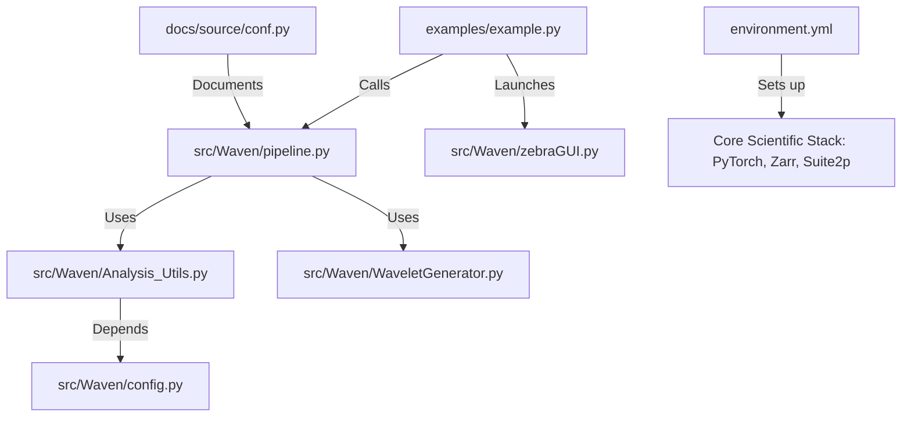

# Repository Overview

Based on the provided repository structure and file summaries, here is the comprehensive overview of the **Waven** research repository.

---

### 1. Repository Purpose
**Waven** is a specialized Python framework for **systems neuroscience research**, specifically designed to analyze neuronal activity in the visual cortex. Its primary goal is to map the relationship between visual stimuli (e.g., natural movies, Gabor-filtered stimuli) and neuronal responses (spike trains or 2-photon imaging signals) to determine receptive field preferences, orientation tuning, and spatial frequency sensitivity.

### 2. Data Pipeline
The repository implements a robust data-processing workflow:
1.  **Ingestion**: Raw visual stimuli (`.mp4`) and neural acquisition data (spike arrays, position coordinates) are loaded.
2.  **Preprocessing**: Stimuli are processed into a library of **Gabor-filtered wavelet features**. Neural data is normalized using micrometer spatial scaling.
3.  **Modeling**: The pipeline computes correlations between the stimulus wavelet coefficients and neural spike responses.
4.  **Analysis**: Receptive fields are estimated, and nonlinear response models are fitted to characterize the visual properties of individual neurons.
5.  **Visualization**: Final results are rendered as retinotopic maps, tuning curves, and receptive field grids.

### 3. Key Scripts & Their Roles
*   **Core Logic (`src/Waven/`)**:
    *   `WaveletGenerator.py`: Generates the bank of Gabor filters and wavelet decomposition.
    *   `Analysis_Utils.py`: Contains the heavy-duty statistical methods (Pearson correlations, trial repeatability, response decay modeling).
    *   `pipeline.py`: Orchestrates the transition from raw data to modeled outputs.
    *   `zebraGUI.py`: Provides an interactive graphical user interface for real-time parameter tuning and data exploration.
*   **Execution Examples (`examples/`)**:
    *   `example.py`: The main entry point to launch the GUI or batch processing.
    *   `run_waven_parts.py`: A modular script for testing specific pipeline stages like RF estimation and model training.
*   **Documentation (`docs/`)**: Configured for Sphinx; includes tutorials and FAQs.

### 4. Analysis Methods Implemented
*   **Gabor/Wavelet Decomposition**: Transforming visual stimuli into a feature-domain representation.
*   **Pearson Correlation Analysis**: Mapping neural response selectivity to visual features (azimuth, elevation, orientation).
*   **Nonlinear Modeling**: Fitting neural response functions to capture non-linearities in visual processing.
*   **Trial Repeatability**: Statistical assessment of response consistency across repeated experimental trials.
*   **Retinotopic Mapping**: Visualizing the spatial distribution of neuronal visual preferences across the cortical surface.

### 5. Outputs & Figures
*   **Diagnostics**: Receptive field grid maps (`Plot_RF`).
*   **Performance Metrics**: Tuning curves for orientation, spatial frequency, and phase (`PlotTuningCurve`).
*   **Spatial Maps**: Retinotopic maps and "visual sign" maps (on/off-center polarity).
*   **Cached Data**: Gabor filter libraries (`.npy`) and wavelet-decomposed stimuli (`.zarr` or `.npy`) to accelerate iterative analysis.

### 6. Dependencies & Environment
*   **Core**: Python 3.10+, PyTorch 2.0.1, NumPy 1.26, SciPy, Pandas.
*   **Imaging/I/O**: OpenCV, Scikit-Image, Tifffile, Zarr (for large array handling).
*   **Analysis/ML**: Scikit-Learn, TensorLy (for tensor decomposition).
*   **Documentation**: Sphinx, Furo theme.
*   **Environment**: Managed via `environment.yml` (Conda) and `requirements.txt`.

### 7. File Dependency Graph
The structure follows a clean separation between core libraries, configuration, and execution interfaces:

***Note on Project Evolution:** Files indicate a transition from a repository previously named "ZebrAnalysis" or "zebrAnalysis3" to the current "Waven" framework. Users should ensure environment paths align with this new package name to avoid import errors.*

Repository Structure:
  .readthedocs.yaml (641 chars)
  README.md (6681 chars)
  docs/conf.py (2674 chars)
  docs/html/_sources/faq.rst.txt (966 chars)
  docs/html/_sources/index.rst.txt (520 chars)
  docs/html/_sources/installation.rst.txt (573 chars)
  docs/html/_sources/quickstart.rst.txt (6182 chars)
  docs/html/_static/scripts/furo.js.LICENSE.txt (187 chars)
  docs/requirement.txt (87 chars)
  docs/requirements.txt (270 chars)
  docs/source/conf.py (2681 chars)
  environment.yml (752 chars)
  examples/example.py (3642 chars)
  examples/run_waven_parts.py (5547 chars)
  pipeline_correlation_plots.py (3833 chars)
  pyproject.toml (755 chars)
  requirements.txt (218 chars)
  source/conf.py (2674 chars)
  src/Waven/Analysis_Utils.py (116894 chars)
  src/Waven/LoadPinkNoise.py (49556 chars)
  src/Waven/WaveletGenerator.py (10851 chars)
  src/Waven/__init__.py (32 chars)
  src/Waven/config.py (14712 chars)
  src/Waven/pipeline.py (14171 chars)
  src/Waven/suite2p/__init__.py (32 chars)
  src/Waven/suite2p/utils/cortex_lab_utils.py (5138 chars)
  src/Waven/suite2p/utils/mpeppy.py (6759 chars)
  src/Waven/suite2p/utils/timelinepy.py (7581 chars)
  src/Waven/suite2p/utils/twophopy.py (10370 chars)
  src/Waven/suite2p/utils/utils.py (26289 chars)
  src/Waven/wavelet_io.py (1761 chars)
  src/Waven/zarr_compat.py (3927 chars)
  src/Waven/zebraGUI.py (24158 chars)
  src/waven/__init__.py (1922 chars)
  src/waven/analysis_utils.py (379 chars)
  src/waven/config.py (542 chars)
  src/waven/gui.py (127 chars)
  src/waven/pipeline.py (1142 chars)
  src/waven/plotting.py (4648 chars)
  src/waven0.1.egg-info/SOURCES.txt (591 chars)
  src/waven0.1.egg-info/requires.txt (93 chars)
  src/waven0.1.egg-info/top_level.txt (13 chars)
  tests/test_zarr_compat.py (1359 chars)
  wavelet_zarr.py (1671 chars)