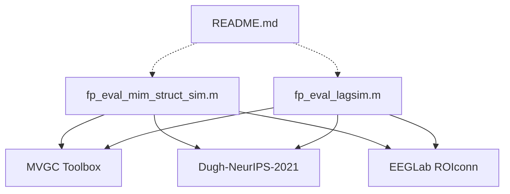

# Repository Overview

This repository, **FCsim**, provides a simulation-based benchmarking framework designed to evaluate the accuracy of pipelines used to estimate inter-regional functional connectivity from EEG sensor data. It acts as the computational foundation for research published in *NeuroImage* (2023).

---

## 1. Repository Purpose
The repository serves as a validation and benchmarking environment. Its primary objective is to quantify how different signal processing and source localization pipelines perform in recovering "ground truth" connectivity from simulated EEG data. By generating controlled artificial signals, it allows researchers to isolate the effects of interaction delays and processing methodology on the reliability of functional connectivity metrics.

## 2. Data Pipeline
1.  **Generation:** The framework generates artificial EEG sensor time series based on predefined simulation parameters.
2.  **Processing:** These signals are passed through various source localization and connectivity estimation pipelines.
3.  **Benchmarking:** The estimated connectivity is compared against the known ground truth used to generate the signals.
4.  **Evaluation:** The system calculates performance metrics to assess the accuracy and sensitivity of the tested pipelines.

## 3. Key Scripts & Their Roles
*   **`fp_eval_mim_struct_sim.m`**: The primary execution script; it orchestrates the core simulation workflow to evaluate functional connectivity estimation methods.
*   **`fp_eval_lagsim.m`**: A targeted script for stress-testing pipelines; it evaluates how variable interaction delays between brain regions impact the precision of the estimation models.

## 4. Analysis Methods Implemented
*   **Source Localization:** Implements advanced methods, most notably the "Champagne" source localization technique.
*   **Connectivity Estimation:** Focuses on linear inter-regional functional connectivity.
*   **Simulation-based Benchmarking:** Systematic evaluation of signal processing pipelines against known ground truths, with a specific focus on sensitivity to timing/lags.

## 5. Outputs & Figures
The repository generates quantitative comparative data. The primary outputs are performance metrics and visualizations that illustrate the accuracy of different pipelines across various experimental conditions (e.g., varying degrees of interaction delay). These outputs directly support the findings in the associated 2023 *NeuroImage* publication.

## 6. Dependencies & Environment
*   **Environment:** MATLAB.
*   **Core Libraries:** 
    *   **MVGC Toolbox:** Used for Granger Causality analysis.
    *   **Dugh-NeurIPS-2021:** Required for the Champagne source localization implementation.
*   **Integration:** The methodology is intended to interface with the **EEGLab (ROIconn plugin)**, which acts as the recommended production-grade implementation of the tools simulated here.

## 7. File Dependency Graph

*(Note: The graph reflects that the simulation scripts utilize the listed toolboxes and external libraries to function.)*

Repository Structure:
  README.md (1560 chars)