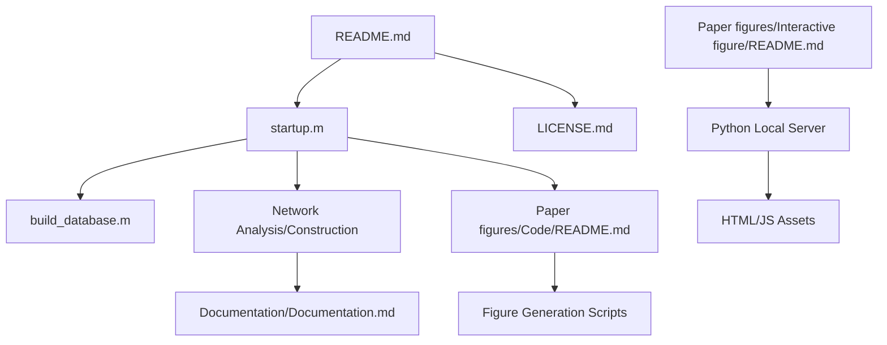

# Repository Overview

This repository contains the **Neurocarta** toolbox, a specialized MATLAB/Octave framework developed by Tido Bergmans (2024) to facilitate the analysis of mouse brain connectivity using data from the Allen Mouse Brain Connectivity Atlas (AMBCA).

---

### 1. Repository Purpose
The primary goal of Neurocarta is to bridge the gap between raw neuroimaging data and graph-theoretical network models. It allows researchers to download, organize, and analyze axonal projection data to study the anatomical connectome of the mouse brain, providing both static statistical outputs and interactive visualizations.

### 2. Data Pipeline
*   **Ingestion:** The pipeline begins by fetching raw experimental metadata and imaging data from the AMBCA.
*   **Normalization:** Raw axonal density tracer data is converted into bilateral adjacency matrices.
*   **Network Construction:** The toolbox compiles these matrices, applying thresholding techniques to filter noise and define edges between specific brain nodes.
*   **Analysis:** Processed networks are subjected to graph-theoretical analysis and matrix algebra.
*   **Dissemination:** Outputs are saved as GEXF files (for external graph software), plots (for paper figures), and web-based interactive visualizations.

### 3. Key Scripts & Their Roles
*   **`build_database.m`**: Initiates the workflow by downloading/importing AMBCA datasets into the local environment.
*   **`loadmap` / `generatemaps`**: Central functions for compiling processed network matrices and applying spatial parameters.
*   **`startup.m`**: Required root-level script to initialize the MATLAB/Octave path for all internal functions.
*   **`[figure_function_files]`**: Dedicated scripts within the `Paper figures/` directory designed to reproduce the specific findings of the associated research paper.
*   **`python3 -m http.server`**: An instruction for serving the web-based interactive figures locally.

### 4. Analysis Methods Implemented
*   **Graph Theory:** Calculation of node degree, shortest/K-shortest paths, and betweenness centrality.
*   **Network Statistics:** Density of States (DOS) matrix calculation, spectral property analysis, and regional averaging (`macromap`).
*   **Data Manipulation:** Normalization of axonal density, thresholding of weak connections, and cross-correlation of experiment maps.

### 5. Outputs & Figures
*   **Network Data:** Adjacency matrices and GEXF-formatted network files for external visualization.
*   **Static Figures:** Scientific plots demonstrating connectivity, projection maps, and comparative analysis of brain regions.
*   **Interactive Content:** Browser-based visualizations of the connectome, served via a local HTTP server.

### 6. Dependencies & Environment
*   **Platform:** MATLAB or GNU Octave.
*   **External Data:** Requires connectivity data from the [Allen Mouse Brain Connectivity Atlas (AMBCA)](https://connectivity.brain-map.org).
*   **Utility:** Python 3 is required for serving the local interactive figure content.
*   **License:** Distributed under the **MIT License**.

---

### 7. File Dependency Graph

Repository Structure:
  Documentation/Documentation.md (4247 chars)
  LICENSE.md (1069 chars)
  Paper figures/Code/README.md (461 chars)
  Paper figures/Interactive figure/README.md (125 chars)
  README.md (2243 chars)