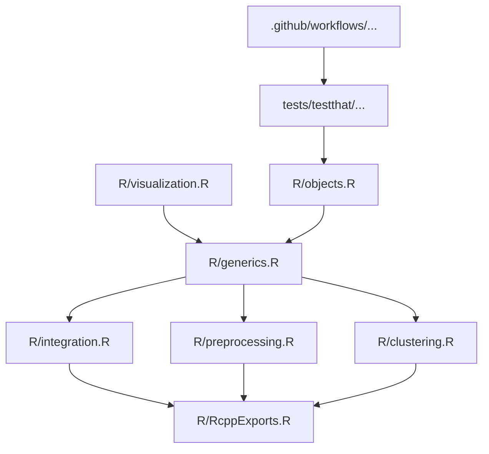

# Repository Overview

This repository contains the **Seurat** R package, a comprehensive toolkit for the analysis and visualization of single-cell and spatial transcriptomics data. It is engineered for high-performance processing, large-scale data integration, and community-driven development in bioinformatics.

---

### 1. Repository Purpose
Seurat provides a standardized, scalable framework for end-to-end single-cell analysis. Its core goals include:
*   **Data Preprocessing**: Normalization, highly variable gene selection, and cell-cycle regression.
*   **Dimensionality Reduction & Clustering**: PCA, UMAP, and community-based clustering (Leiden/Louvain).
*   **Integration**: Merging disparate datasets (e.g., across species, technologies, or conditions) to remove batch effects.
*   **Spatial Analysis**: Specialized support for spatially resolved transcriptomics (Visium, Xenium, CODEX).
*   **Extensibility**: Interoperability with Bioconductor and other R-based genomic toolkits.

### 2. Data Pipeline
The repository follows a typical "Object-Oriented" data flow common in R bioinformatics:
1.  **Ingestion**: Loading raw counts/metadata (`Load10X`, `ReadSTARsolo`, `LoadXenium`) into a `Seurat` object.
2.  **Normalization & Transformation**: `SCTransform` or log-normalization of sparse matrices (`dgCMatrix`).
3.  **Dimensionality Reduction**: Calculation of PCA/LSI embeddings using optimized C++ backend.
4.  **Integration/Correction**: Multi-dataset alignment via anchor-based workflows (`IntegrateLayers`).
5.  **Clustering & Marker Discovery**: Graph-based cluster identification followed by differential expression analysis (`FindMarkers`).
6.  **Visualization**: Rendering plots for dimensionality reduction, spatial coordinates, and expression patterns.

### 3. Key Scripts & Their Roles
*   **`R/objects.R`**: Defines the foundational `Seurat` S4 object structure and accessor methods.
*   **`R/preprocessing.R` & `R/integration.R`**: Core logic for data normalization, scaling, and multi-dataset integration.
*   **`R/visualization.R`**: Extensive plotting suite (ggplot2-based) for dim-plots, heatmaps, and spatial visualizations.
*   **`R/clustering.R`**: Implements community-detection algorithms and multi-modal neighborhood graph construction.
*   **`R/differential_expression.R`**: Handles statistical tests for finding marker genes.
*   **`R/RcppExports.R`**: Interfaces with high-performance C++ code for computationally intensive tasks like SNN-graph construction and row-wise matrix statistics.
*   **`.github/workflows/`**: Orchestrates CI/CD via CRAN-standard `rcmdcheck` and unit testing.

### 4. Analysis Methods Implemented
*   **Clustering**: Leiden, Louvain, and SLM algorithms for modularity optimization.
*   **Integration**: Anchor-based integration to remove batch effects.
*   **Statistics**: Differential expression using Wilcoxon, ROC, t-test, and Poisson models.
*   **Dimensionality**: PCA, UMAP, and UMAP-projection via nearest-neighbor mapping.
*   **Large-scale Processing**: Data sketching via leverage scores for sub-sampling and accelerated analysis.

### 5. Outputs & Figures
*   **Computed Metadata**: Statistical scores, cluster assignments, and dimension embeddings.
*   **Visualization**: High-quality static images (PDF/PNG via ggplot2) including `DimPlot`, `SpatialPlot`, `FeaturePlot`, and `VlnPlot`.
*   **Diagnostics**: QC reports, cluster trees, and gene loading plots.

### 6. Dependencies & Environment
*   **Infrastructure**: `Rcpp` (C++ interface), `future` (parallelization), `Matrix` (sparse matrix support).
*   **Bioinformatics Core**: `igraph` (graph analysis), `leidenbase` (clustering), `uwot` (UMAP).
*   **CI Environment**: `satijalab/seurat-ci` Docker image, `rcmdcheck`, `testthat`.
*   **Data Format Compatibility**: Support for H5, Parquet, and various vendor-specific formats (e.g., 10x, Xenium, Vizgen).

### 7. File Dependency Graph (Conceptual)

*Note: The repository exhibits high modularity, where `generics.R` acts as the central interface dispatcher for the specialized logic found in the `preprocessing`, `integration`, and `clustering` files, all backed by the performance engine in `RcppExports.R`.*

Repository Structure:
  .github/ISSUE_TEMPLATE/bug-report.yml (1874 chars)
  .github/ISSUE_TEMPLATE/config.yml (205 chars)
  .github/ISSUE_TEMPLATE/documentation.yml (772 chars)
  .github/ISSUE_TEMPLATE/feature-request.yml (930 chars)
  .github/pull_request_template.md (1606 chars)
  .github/workflows/merge_checks.yaml (2536 chars)
  .github/workflows/release_checks.yaml (3373 chars)
  .github/workflows/reverse_dependency_checks.yaml (295 chars)
  CODE_OF_CONDUCT.md (3352 chars)
  LICENSE.md (1073 chars)
  NEWS.md (49205 chars)
  R/RcppExports.R (5092 chars)
  R/clustering.R (62257 chars)
  R/convenience.R (13884 chars)
  R/data.R (1467 chars)
  R/differential_expression.R (84551 chars)
  R/dimensional_reduction.R (91609 chars)
  R/generics.R (28188 chars)
  R/integration.R (292301 chars)
  R/integration5.R (27078 chars)
  R/mixscape.R (50000 chars)
  R/objects.R (103900 chars)
  R/preprocessing.R (208549 chars)
  R/preprocessing5.R (56035 chars)
  R/reexports.R (8440 chars)
  R/roxygen.R (1520 chars)
  R/sketching.R (26455 chars)
  R/tree.R (12447 chars)
  R/utilities.R (97393 chars)
  R/visualization.R (317854 chars)
  R/zzz.R (3387 chars)
  README.md (1536 chars)
  _pkgdown.yaml (5878 chars)
  index.md (5794 chars)
  inst/extdata/pbmc_raw.txt (39888 chars)
  man/roxygen/templates/note-reqdpkg.R (137 chars)
  man/roxygen/templates/param-dotsi.R (22 chars)
  man/roxygen/templates/param-dotsm.R (49 chars)
  man/roxygen/templates/section-future.R (727 chars)
  man/roxygen/templates/section-progressr.R (554 chars)
  man/roxygen/templates/seealso-methods.R (72 chars)
  tests/testthat/test_data_manipulation.R (9554 chars)
  tests/testthat/test_differential_expression.R (29998 chars)
  tests/testthat/test_dimensional_reduction.R (4686 chars)
  tests/testthat/test_find_clusters.R (4923 chars)
  tests/testthat/test_integratedata.R (6356 chars)
  tests/testthat/test_integration.R (26638 chars)
  tests/testthat/test_integration5.R (15900 chars)
  tests/testthat/test_load_10X.R (9238 chars)
  tests/testthat/test_modularity_optimizer.R (4735 chars)
  tests/testthat/test_objects.R (991 chars)
  tests/testthat/test_preprocessing.R (27908 chars)
  tests/testthat/test_sketching.R (6509 chars)
  tests/testthat/test_spatial.R (9929 chars)
  tests/testthat/test_transferdata.R (7726 chars)
  tests/testthat/test_tree.R (2239 chars)
  tests/testthat/test_utilities.R (16572 chars)
  tests/testthat/test_visualization.R (2328 chars)
  tests/testthat.R (287 chars)
  vignettes/archive.yaml (2674 chars)
  vignettes/assets/pbmc_dcs_cells.txt (525 chars)
  vignettes/vignettes.yaml (10984 chars)
  vignettes/vignettes_v5.yaml (2421 chars)
  vignettes/vignettes_v5_new.yaml (11814 chars)