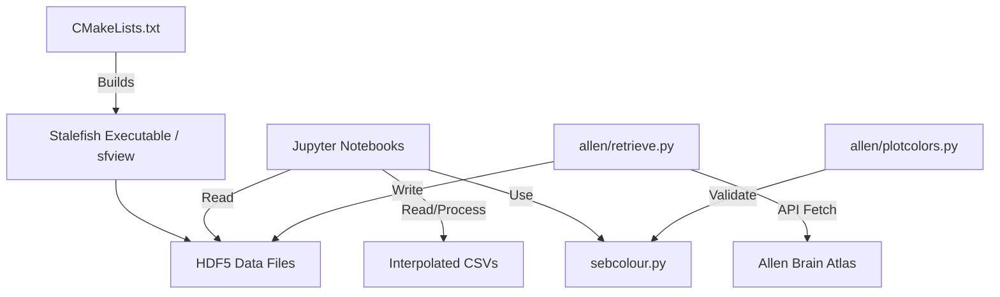

# Repository Overview

This repository, **Stalefish**, is a specialized scientific software suite for neurobiologists focused on the 3D reconstruction, spatial normalization, and comparative analysis of gene expression data (specifically *in situ* hybridization) in vertebrate brains.

### 1. Repository Purpose
Stalefish facilitates the conversion of raw 2D brain slice images into 3D expression maps. It supports workflows for:
*   **Reconstruction**: Digitally "unwrapping" 3D cortical surfaces from histological 2D slices.
*   **Standardization**: Aligning brain samples to common templates (Allen Mouse Brain Atlas).
*   **Comparative Neurobiology**: Quantifying gene expression similarities across cortical layers, developmental stages, and species (e.g., mouse vs. vole).

### 2. Data Pipeline
The pipeline follows a structured path from raw acquisition to statistical comparison:
1.  **Retrieval**: Python scripts fetch raw ISH image data and metadata from the Allen Brain Atlas API.
2.  **Preprocessing**: Users define anatomical curves on 2D images; Stalefish computes signal intensity along these curves to generate 3D meshes.
3.  **Storage**: Data is exported as HDF5 (`.h5`) files, which contain coordinates, expression levels, and slice geometry.
4.  **Normalization**: Jupyter Notebooks perform slice-wise interpolation and statistical scaling (Z-score, Min-Max, mean-centering) to handle inter-sample variability.
5.  **Analysis**: Normalized data is aggregated into population heatmaps for cross-species or cross-condition comparison.

### 3. Key Scripts & Their Roles
*   **`Stalefish_Analysis_*.ipynb`**: Jupyter notebooks that serve as the analytical engine. They perform the interpolation, statistical normalization, and generation of comparative heatmaps.
*   **`allen/retrieve.py` & `allen/template_mouse_brain/retrieve_template.py`**: Automated utilities to interface with the Allen Brain Atlas API for downloading experimental data and anatomical templates.
*   **`sfview` (C++)**: The primary GUI/visualization executable used to render 3D meshes and perform manual image annotation.
*   **`allen/sebcolour.py`**: A centralized color-management module ensuring consistent visualization styles across all figures.

### 4. Analysis Methods Implemented
*   **Spatial Interpolation**: Uses `scipy.interpolate.interp1d` to remap irregular, slice-based data to a uniform linear distance grid.
*   **Normalization**: Implements Z-score, Min-Max, and background-level normalization to correct for experimental staining variances.
*   **Correlation Analysis**: Employs Pearson correlation coefficients (via `numpy.corrcoef`) to quantify spatial similarity between gene expression patterns.
*   **Registration**: Uses manual landmark annotation and API-based coordinate offsets to align disparate brain slices.

### 5. Outputs & Figures
*   **Visualizations**: High-resolution heatmaps, correlation matrices (as `.pdf` or `.svg`), and 2D/3D rendered expression surfaces.
*   **Intermediate Data**: HDF5 project files and interpolated CSVs containing processed expression signals.
*   **Diagnostic Plots**: 3D scatter plots comparing color spaces for expressing vs. non-expressing pixels (validation of ISH data).

### 6. Dependencies & Environment
*   **Core Build**: C++17, CMake, OpenMP, and `morphologica` (internal dependency).
*   **Scientific Stack**: `numpy`, `pandas`, `scipy`, `scikit-learn`, `h5py`, `matplotlib`, `seaborn`, `OpenCV`.
*   **System Tools**: `wget` (for API retrieval), `libomp`, `FreeType`, `GLFW` (for OpenGL rendering).

### 7. File Dependency Graph

*(Note: The repository is highly modular, with CMake managing the compilation of core C++ libraries while Jupyter notebooks utilize Python’s scientific stack for the high-level analytical phase.)*

Repository Structure:
  CMakeLists.txt (2981 chars)
  LICENSE.txt (35149 chars)
  README.md (12685 chars)
  Stalefish_Analysis_Correlations_3.5.21.ipynb (144375 chars)
  Stalefish_Analysis_Single_Brain.ipynb (14065 chars)
  Stalefish_Combined_Cases_CONTROL.ipynb (8074 chars)
  Stalefish_Combined_Cases_P4ENUC_all.ipynb (6135 chars)
  allen/CMakeLists.txt (221 chars)
  allen/expt/readme.md (89 chars)
  allen/genes.sh (364 chars)
  allen/plotcolors.py (3182 chars)
  allen/retrieve.py (11725 chars)
  allen/retrieve_forpaper.sh (217 chars)
  allen/sebcolour.py (41672 chars)
  allen/template_mouse_brain/retrieve_P56_coronal.sh (230 chars)
  allen/template_mouse_brain/retrieve_template.py (12736 chars)
  allen/template_mouse_brain/threemaps.sh (193 chars)
  data/CMakeLists.txt (71 chars)
  mac/README.md (849 chars)
  mac/bundle.sh (3241 chars)
  mac/sf_icons.iconset/sf_dafticon.sh (480 chars)
  mac/sf_icons.iconset/sf_rendericon.sh (553 chars)
  mac/sf_icons.iconset/sf_sliceicon.sh (486 chars)
  mac/sfv_icons.iconset/sf_sliceicon.sh (486 chars)
  mac/sfv_icons.iconset/sfview_view.sh (538 chars)
  mac/sfviewbundle.sh (2957 chars)
  misc/README.md (89 chars)
  misc/paper_figures/Fig_depth/Fig_depth.py (4860 chars)
  misc/paper_figures/Fig_depth/sebcolour.py (41672 chars)
  misc/paper_figures/Fig_depth/svg/README.md (65 chars)
  misc/plot_contours.py (2773 chars)
  reading/README.md (12672 chars)
  reading/octave/README.md (1449 chars)
  reading/python/Fig_depth.py (5138 chars)
  reading/python/README.md (4767 chars)
  reading/python/depth_plots.py (2973 chars)
  reading/python/plot_one.py (1601 chars)
  reading/python/plot_triplechannel.py (1248 chars)
  reading/python/read_example.py (3285 chars)
  reading/python/showmap.py (5410 chars)
  reading/python/showmap_contours.py (6246 chars)
  snap/snapcraft.yaml (2102 chars)
  src/CMakeLists.txt (2111 chars)